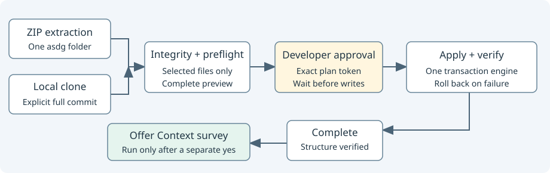

# Two installation paths regression tests

[Source](test_install.py). Exercise the public initialization boundary in disposable Git projects.

`InstallTests` owns source/target fixtures and calls `cli_install.install`; one subprocess test exercises the actual Python entry point.
Coverage includes both routes and clients, no-write preview, explicit apply token, source identity/commit/path rejection, stale hashes, source changes, stale plans, client changes, collisions, post-verification rollback, interrupted package writes, symlink/collision protection and idempotency.
Provider-only adapters, application files and project Context notes test the copy boundary. An inactive sprint and an unexecuted separately consented Context survey test completion boundaries.
A frozen clock proves deterministic report equality; native Claude/Codex applications are not launched.
Only disposable source repositories are committed to establish real Git blob evidence; target repositories remain uncommitted.
Run `python3 -B -m unittest discover -s asdg/tests -p test_install.py -v`; use Python 3.9 for compatibility evidence.
