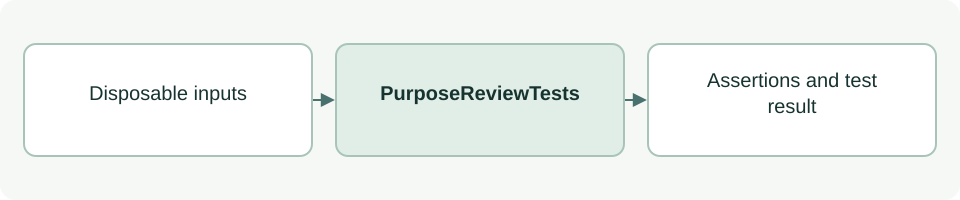

# Purpose acceptance tests

[Source: test_purpose_review.py](test_purpose_review.py)

Checks that document presence, agent readiness and human acceptance remain separate, and that edits invalidate acceptance without rewriting history.

## Responsibilities and collaborators

Owns deterministic regression fixtures and assertions for the behavior described below.

- [purpose_review](../scripts/lib/purpose_review.md): Purpose event/bundle validation.
- [cli_status](../scripts/lib/cli_status.md): Derived empty Context and lifecycle readback.
- [cli_project](../scripts/lib/cli_project.md): Scaffold constants used by fixtures.

## Interface and data

PurposeReviewTests extends unittest.TestCase. Test methods use per-test state; simulated decisions never modify real project acceptance.

| Callable or interface | Contract |
| --- | --- |
| `setUp() -> None` | Creates isolated Purpose documents, image bytes and an empty review entry. |
| `ready() -> dict; accept() -> dict` | Appends synthetic readiness/acceptance events to the fixture and returns each event. |
| `context_status(context=None) -> list[dict]` | Evaluates fixture Context, Purpose and Use Case stages. |

The [test case guide](test_purpose_review-cases.md) lists every `test_*` method and the behavior it checks.

## Effects and failure behavior

Test images are byte fixtures, not renderable visual evidence. Events use simulated statements. Temporary files are cleaned up by unittest.

## Example

From the project root: `TMPDIR=/private/tmp python3 -B -m unittest discover -s asdg/tests -p 'test_purpose_review.py'`.
