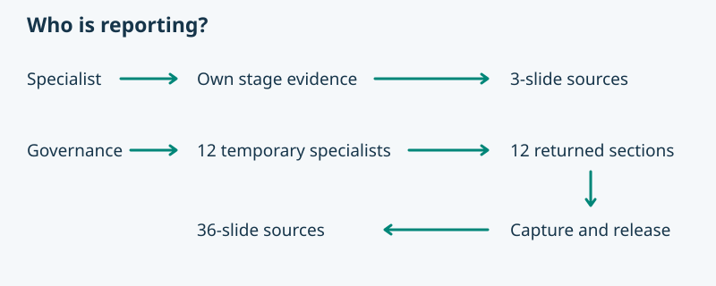

# Status report regression tests

These provider tests check the reporting contract using synthetic returns and the installed role catalogue. Run them with the renderer environment’s Python and `-B -m unittest discover -s asdg/tests -p test_report_project_status.py -v`.

| Check | Evidence |
| --- | --- |
| Packet validity and binding | Rejects wrong run, project, role, snapshot, missing role sources, incomplete slide data and duplicate JSON keys. |
| Coverage and order | Reversed returns yield lifecycle order, a missing role yields one coverage slide, all missing blocks, and duplicate worker receipts fail. |
| Platform and dependencies | Claude’s direct specialist path passes, unsupported Governance dispatch blocks and missing renderer location is explicit. |
| Source-first handoff | Reads the illustrated Markdown, notes, visuals and originals without a renderer. A source-only rebuild reflects a note revision and preserves the revised source bytes. |
| Actual renderer | Builds and reopens 3-, 36- and 34-slide fixtures with the provider builder. Checks each slide’s title, narration, sources and order. Requires the provider’s pinned rendering dependencies and system Cairo. |

The distribution suite independently checks a fresh ZIP installation, adapters, help and relocation. Fixture worker identifiers exercise accounting only. Real host dispatch, capability discovery, guard behavior and worker release require native client evidence.
