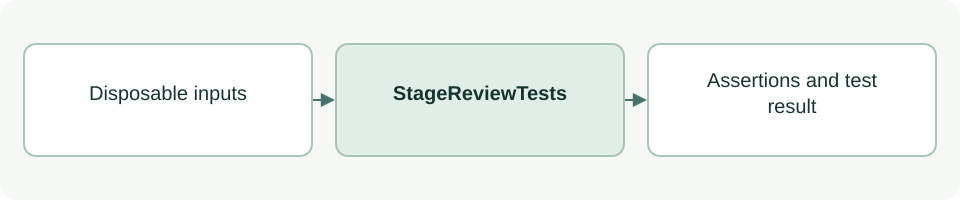

# Stage acceptance tests

[Source: test_stage_review.py](test_stage_review.py)

Checks stage-local documentation acceptance, dependency hashing and readback without mutating lifecycle state.

## Responsibilities and collaborators

Owns deterministic regression fixtures and assertions for the behavior described below.

- [stage_review](../scripts/lib/stage_review.md): Generic review and dependency traversal.
- [cli_status](../scripts/lib/cli_status.md): Lifecycle validation and reporting.

## Interface and data

StageReviewTests extends unittest.TestCase. Test methods use per-test state; simulated decisions never modify real project acceptance.

| Callable or interface | Contract |
| --- | --- |
| `setUp() -> None` | Creates a linked system/scenario/image/diagram fixture and stage entry. |
| `ready() -> dict; accept() -> None` | Appends simulated readiness and User acceptance events. |
| `status() -> dict` | Evaluates completion for the fixture Stage 03. |

The [test case guide](test_stage_review-cases.md) lists every `test_*` method and the behavior it checks.

## Effects and failure behavior

Test_* methods return None and signal problems with unittest assertions. Fixture images/source files only test hash dependencies; they do not validate real diagrams or human identity.

## Example

From the project root: `TMPDIR=/private/tmp python3 -B -m unittest discover -s asdg/tests -p 'test_stage_review.py'`.
