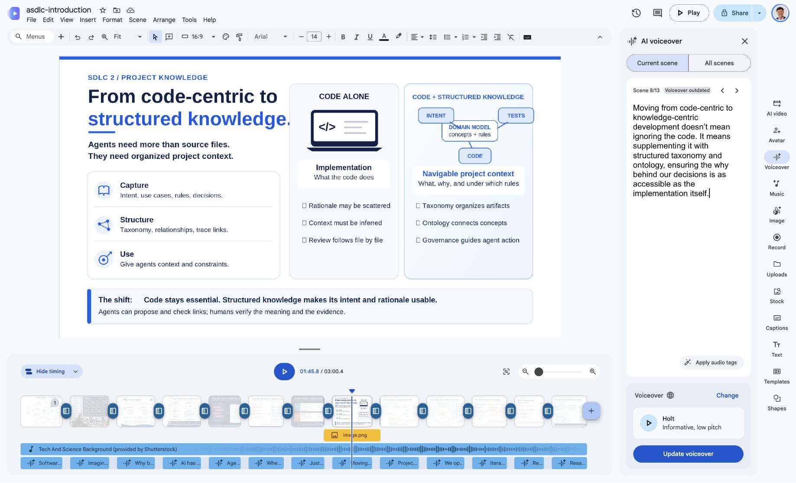

# Earlier introduction correction and publication queue

The affected recording is [Earlier ASDLC Overview](https://www.youtube.com/watch?v=RUyP6nvC8cE). The newer recommended introduction `ttQZylKeFdg` was not changed.

The supplied corrected MP4 matches SHA-256 `0564ef958e9ebce10808c567160b5806c0668b630fadc3481445bd525b819c11`, is 14,205,816 bytes and runs 180.535011 seconds. Full FFmpeg decoding passes; it contains H.264 video, AAC audio and embedded text subtitles. Its duration matches the old asset within a millisecond.

At the requested interval, subtitle 59 ends with “ensuring the”; subtitle 60 reads “why behind our” from 108.701–109.676 seconds. No quote repetition appears in the corrected captions. The session cannot consume audio input, so listening across 1:46–1:51 and voice/join quality remain unverified.

## Source and public correction

The original short Google Vids source was located. Scene 08 contained quotation markup around why; that markup was removed and Saved to Drive was observed. A [separate short-video script](../../../docs/presentations/asdg-introduction/short-video-slide-08.md) records the corrected wording. The SVG and all longer notes remain unchanged.



Vids flags the existing voiceover as outdated. It was not regenerated, because preserving the supplied original voice/timing is preferable to unverified new synthesis. The corrected supplied MP4 is the release candidate; future Vids exports need refreshed/replaced audio and a listening check.

The existing public YouTube auto-caption transcript still contains “quote quote quote” at 1:48. This supports the reported defect; it is not an auditory observation. No edit to the public video was saved.

Studio has an unsaved cut preview at approximately 108.033–109.167 seconds, represented at 30 fps as `1:48:01`–`1:49:05`. Preview playback was exercised and paused at 1:46. Because “the” → “why” could not be heard here, the remaining manual step is to listen, adjust frame boundaries if needed, save only after a natural join, wait for processing and verify the same public URL and captions.

## GitHub release handoff

The live release API reports asset ID `710936087`, size 12,597,245 and old SHA-256 `663504a062e27afeb81c38b86198fb5ad41412a4203dd1e855ad509db0e88e97`. Replacement remains needed. The release was not modified.

Prepared file: `docs/presentations/asdg-introduction/build/release-correction/asdg-introduction-narrated.mp4`. From the repository root, Pablo can run:

```sh
gh release upload v0.3.0-pilot.1 docs/presentations/asdg-introduction/build/release-correction/asdg-introduction-narrated.mp4 --repo Elustondo-ai/agentic-sdlc-governance --clobber
```

Verify the live asset digest again afterward. This command is provided for the human; it was not executed here.

## Queue outcome

The existing queue remains ten recorded public videos and eleven ready videos. Retrying `recent-07` through its existing Google Vids source produced the current error “You’ve reached your upload limit.” No further exports were attempted after that shared blocker and no video was newly published.

The queue retains existing IDs, sources, grouping and watch URLs, adding only the fresh failure evidence and the earlier introduction’s pending correction state. Public/HD verification for remaining uploads must follow successful publication; it is not inferred from readiness.

The user's section 2 was truncated after “Start from docs/reviews/asdg”; the missing continuation was requested and was not received during this work. The account-wide quota independently blocks finishing the queue.

Source/link and screenshot review were performed. The adjacent JSON records hashes, observed outcomes and limits. No commit, push, GitHub replacement, sharing change, sprint or unrelated source edit occurred in this task.
