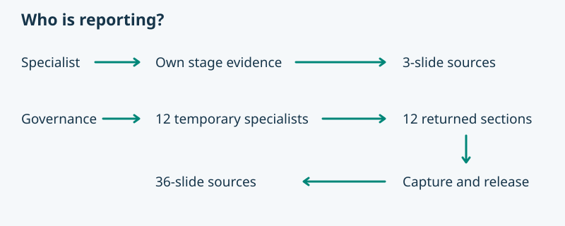

# Project-status reporting candidate

Pablo requested a context-sensitive PowerPoint report and supplied an integration review covering packaging, rendering, Claude capability and executed regression tests. This revised candidate is prepared against clean provider HEAD `25dabd348a15b8bab98bd6f94a28d03e5228638e`. It awaits human review.

## Changed scope

The report workflow, shared adapter and packet checker are explicitly packaged. The skill index and Help expose the command. Direct specialists prepare three slides. Codex Governance requires observable named-role dispatch. The current Claude integration supports the direct path only. Governance writes an illustrated Markdown presentation and its editable slide sources under its own authorized client directory. Shared originals live in a sibling images directory.

The Markdown, visuals and notes can be delivered and inspected without a renderer. The final PowerPoint export under presentation/build/ requires a reviewed external provider renderer and its dependencies. The portable ZIP supplies the report workflow and checker. Packet checking distinguishes complete, partial and blocked coverage, validates the snapshot and stage ownership, and orders the returned sections by lifecycle stage.

## Verification

The focused tests exercise a real ZIP install, relocation, both integration formats and packet processing, including missing roles, missing renderer and a false delegation claim on Claude. The renderer test generates and reopens three synthetic PowerPoints with 3, 36 and 34 slides, including ordered narration and sources. See the adjacent change receipt for commands and results.

The fixtures are synthetic. Native session discovery, dispatch, role activation, receipts and release still require an actual Codex runtime. Effective write interception remains dependent on the client's guard, trust and role context. No release or human acceptance follows from these tests.
