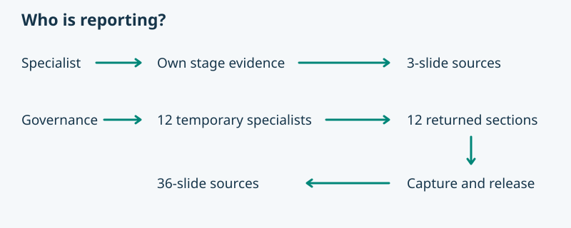

# Project status reporting — applied candidate and native trial

Pablo requested: “Apply the reviewed `asdg-report-project-status` patch to my ASDG provider working tree and leave it uncommitted for me.” He also requested a disposable-client Purpose report followed by Governance reporting through the actual named specialists. This is bounded Admin maintenance and verification; human acceptance remains pending.

The reviewed 21-file patch was applied to clean provider commit `25dabd348a15b8bab98bd6f94a28d03e5228638e`. Its SHA-256 is `05b382f7d5606ca1abf95734324b51f024e5befe97f3ad1d785eae71200f550e`. The [earlier candidate record](02.23-review-project-status-report.md) retains the supplied handoff's provenance; this record reports the local application and observed trial separately.

## Source deliverable and test boundary

The editable `presentation/README.md`, numbered SVG/Markdown slide folders and any sibling original artwork are primary. PowerPoint and its preview/manifest are generated under `presentation/build/`. The report skill and packet checker ship in the candidate package; the presentation renderer remains an explicitly selected provider dependency.

The [disposable trial](../../../build/report-project-status-trial/) uses a newly initialized, uncommitted Git client with a clearly labeled reporting-test README. It has no application, active sprint, deployed service, product research or accepted product baseline. Real native agents read this evidence; missing stage facts must remain unknown.

The native Purpose invocation completed its [three-slide source report](../../../build/report-project-status-trial/client/docs/asdg/02-purpose/reports/purpose-live/presentation/README.md) with zero child dispatches. Native Governance collected all twelve named specialists and completed its [36-slide source report](../../../build/report-project-status-trial/client/docs/asdg/00-governance/reports/governance-live/presentation/README.md). Both have verified PowerPoints under their own `presentation/build/`. The [worker audit](../../../build/report-project-status-trial/specialist-return-audit.json) preserves twelve unique identities, packet hashes, observed completions and null release times.

Purpose checked 31 source links; Governance checked 362 links/anchors and all 36 visuals. Both PowerPoints were reopened programmatically with matching slide order, narration and source hashes. Governance's preservation audit checked all 516 existing baseline files: only the authorized review ledger changed, preserving its 46 prior events and appending 104 authorship events with no human approval. All new client files stayed inside Governance's owned report folder.

## Verification and limits

The standard-library suite ran 148 tests: 146 passed and two renderer tests were skipped. The provider renderer environment separately passed all ten reporting tests, including source-only rebuilding and the slide-2 narration edit. Package integrity and patch whitespace checks passed.

The existing presentation suite initially passed 30 tests and failed one macOS `/var` versus `/private/var` path assertion. All 31 passed with canonical temporary-directory configuration; no test or renderer code was changed for that environment issue.

The live client exposed an export-ignore gap: `git check-ignore` does not recognize `presentation/build/presentation.pptx`. The provider ignores the whole trial directory, but the nested client's managed rules in `asdg/scripts/lib/cli_project.py` cover only logs and caches. The Purpose source index describes the intended ignored-build convention, which this client does not yet implement. A proposed follow-up is a managed `/docs/asdg/**/presentation/build/` exclusion with installation/upgrade coverage; it was not added to the reviewed patch or the client's Git controls.

Named invocation and completion were observed through the host. It exposes no explicit worker close/release API; completion and capacity reuse must not be labeled destruction or release. One stalled coordinator turn was resumed with its earlier packets preserved; no specialist packet retries or dispatch errors occurred. Recoverable authoring/preflight errors are retained in the Governance receipt. Newly installed adapter auto-discovery, trusted-hook interception, native Claude invocation, embedded Markdown viewing and native PowerPoint UI use remain unverified.

No provider files were staged or committed. No push, publication, lifecycle acceptance, sprint transition or hook-trust change occurred. The [machine receipt](02.24-review-report-live-trial.json) retains the final file inventory, results and outstanding limits for Pablo's review. Trial outputs and the linked handoff bundle remain under ignored `build/`; the local portable ZIP is an unpublished working-tree candidate.
