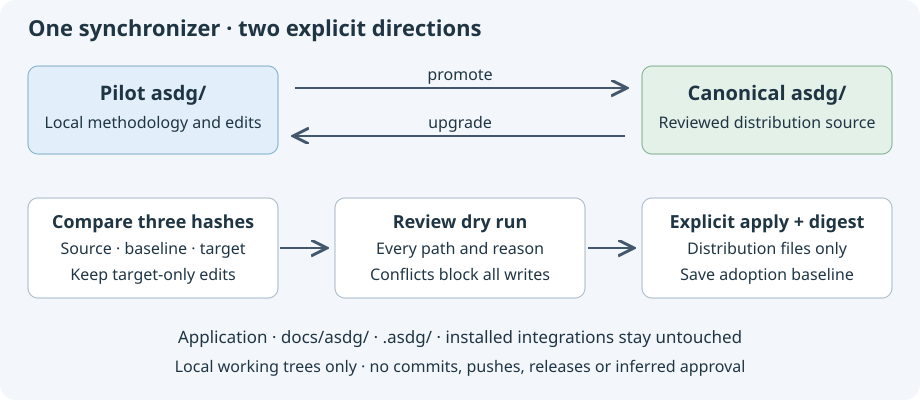

# Reconcile governance and documentation

These are proposed decisions, not applied edits. B is the shared delivery manifest's exact file content; S is Speaker Coach; T is canonical.
The hashes and three-way diffs are in the [inventory](../../reviews/asdg-sync-review/conflicts/inventory.json). `Absent` means no file existed in B, not that its source is unknown.
See the [review procedure](02.3-review-synchronization.md) before authorizing any reconciliation.

| File / exact diff | Baseline B | Source S changes | Target T changes | Proposed resolution |
| --- | --- | --- | --- | --- |
| 01 [document-reviews.json](../../reviews/asdg-sync-review/conflicts/01.diff) | 673 review events. | Preserves B; grows to 1,379 events. | Contains all 1,379 as an exact prefix, plus 425 events at review start. | Retain T and this task's appended receipts. Preserve order, duplicates, full provenance and exact approval bindings. Nothing from S is missing. |
| 02 [asdg/AGENTS.md](../../reviews/asdg-sync-review/conflicts/02.diff) | Earlier client-only instructions. | Adds explicit Admin, current session/bootstrap rules, documentation authority and existing application gates. | Retains those changes; separates canonical package checks from initialized-client status and describes upstream/downstream ownership. | Retain T. This preserves S's rules without treating the provider as an application; no gate or lifecycle identity changes. |
| 03 [asdg/README.md](../../reviews/asdg-sync-review/conflicts/03.diff) | Pilot introduction and initialization. | Adds client selection, team/sprint guidance, Speaker Coach wording and sibling-generated presentation links. | Generic ZIP/init/verify workflow, portable links, current candidate limits and synchronization guide. | Use T as base; restore compact portable team/sprint links and the reminder to version methodology/state. Preserve presentation references as optional provider learning material, without requiring sibling builds or asserting publication. |
| 04 [docs/installation.md](../../reviews/asdg-sync-review/conflicts/04.diff) | Primarily Codex setup. | Adds Claude/both, managed bootstrap, client selection, preservation and native checks. | Keeps S; clarifies provider versus client and selected-package integrity. | Retain T; preserve both clients and trust boundaries. Existing text saying repeat setup “restores” differing entries should be clarified to say it refuses differing managed files, per actual code. |
| 05 [proposal README](../../reviews/asdg-sync-review/conflicts/05.diff) | Absent. | Introduces concern-strategy navigation and a relative link into the pilot's project evidence. | Same proposal, with the client evidence identified as historical provenance rather than a portable dependency. | Retain T; preserve proposal status and exact pilot commit/path attribution. Do not copy client evidence into the distribution. |
| 06 [docs/review-loop.md](../../reviews/asdg-sync-review/conflicts/06.diff) | Pilot baseline and older read-only/recording guidance. | Current documentation authority, explicit Admin and flat numbered review records. | Keeps S; removes specific app.js/index.html assumptions and restores canonical distribution ownership. | Retain T; preserve source governance improvements and historic manifests, without making an old sibling checkout a runtime dependency. |
| 07 [scripts/README.md](../../reviews/asdg-sync-review/conflicts/07.diff) | Plain entry-point list. | Adds companion links and test/runtime navigation. | Adds the portable ZIP builder entry. | Retain T, which preserves all S navigation plus the implemented builder. |
| 08 [scripts/check.md](../../reviews/asdg-sync-review/conflicts/08.diff) | Absent. | Documents a broad package walk and known external-link failures. | Describes explicit package selection, link closure and current-candidate integrity. | Retain T because it matches the current checker; retain S's separation of static checks from native behavior. |
| 09 [scripts/lib/README.md](../../reviews/asdg-sync-review/conflicts/09.diff) | Short runtime overview. | Adds complete module/companion navigation. | Keeps that catalogue and adds distribution selection plus two synchronization modules. | Retain T; no source capability is dropped. |

Most target differences preserve pilot improvements while making them portable. This conclusion follows inspected hunks, not version ordering.
For file 01, semantic event comparison used complete JSON event objects and multiplicities; no timestamp-based collapsing or retargeting of approvals is proposed.
This review's local provenance appends are separate from the nineteen reconciliation proposals. Only the authorized defect's companion update touches another conflicted file.
