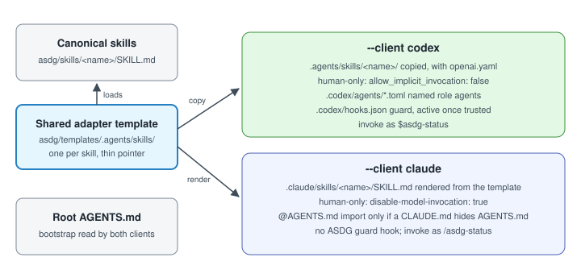

# Refresh client integrations after an approved upgrade

Methodology adoption and installed client integration are separate operations. The current upgrader writes only distribution files and its local adoption record.
This is a proposed extension of the existing initializer and transaction code, not an implemented refresh command or authorization to modify a real client.

## Actual behavior and gap

`cli_project.client_files` produces Codex templates/config/hooks and `cli_clients.claude_files` renders Claude skills from shared templates.
`initialize` plans these files without replacement permission, so a changed installed adapter conflicts; repeat init is not an upgrade migrator.
`verify` compares installed bytes with current generated bytes; it can report DAMAGED after a valid methodology-only upgrade.
`.asdg/integrations.json` currently records selected clients, not generated-file baseline hashes. Its schema is strict; adding hashes requires an explicit backwards-compatible schema change.
Leaving `.codex/hooks.json` unchanged does not guarantee unchanged hook behavior: it executes code under `asdg/scripts/`, which a methodology upgrade can change.

## Proposed reviewed refresh

1. Before adopting an upgrade, record selected clients, their last installed generated hashes and the old package/renderer identity; retain local bytes and customizations. Do not infer a baseline from the new templates.
2. Generate new expected bytes with the existing `client_files`, `claude_adapter`, bootstrap and hook generators. Compare old-generated / new-generated / installed content using the shared hash classification and file transaction.
3. Preview adapters/managed instruction blocks separately from hook/config changes and changed hook-runtime dependencies. Show exact before/after bytes and a digest binding the source, target and selected groups.
4. After explicit refresh authorization, update only approved managed paths. Preserve project-owned text and custom configuration; unknown ancestry, dual edits and untracked deletions remain conflicts. No client is added or removed implicitly.
5. Hooks and trust-related configuration require an explicitly approved group; default adapter refresh leaves them pending. Changes to the invoked hook code and dependencies also require visible review even when hook JSON is unchanged.
6. Atomically record generated hashes and package/renderer identity only after successful writes, using the existing integration receipt with a reviewed schema migration. Preserve `.asdg/` lifecycle, sprint and evidence records.
7. Run structural verify and show pending groups honestly; never report COMPLETE while required integration updates remain pending. Reload each selected native client and observe discovery/invocation; the human reviews trust through that client's own controls.

A previous hash can come from a verified earlier distribution rendered with the recorded generator. For legacy receipts without that evidence, stop at a manual three-way review; never silently bless current custom bytes as generated.
No refresh grants trust, edits native trust stores, bypasses a denied hook, enables a client unasked or starts a sprint. A denied operation is handed to the human terminal under the existing policy.
Claude currently receives skills and an optional instruction bridge, with no ASDG hooks or named agents; preserving this difference is part of compatibility.

## Required acceptance tests

Use disposable clients for unchanged and changed templates, both-client isolation, local customizations, missing/legacy baselines, managed-block preservation, rollback and repeat idempotency.
Verify that omitted hook authorization leaves hook/config bytes unchanged and reports pending work; test changed hook code with unchanged JSON so behavior changes cannot be hidden.
Native discovery and invocation, and trust behavior after changed hook code/configuration, require separate observed evidence in each supported client/version.
Manifest integrity, automated tests and an adopted-version receipt do not grant methodology approval or native hook trust.
