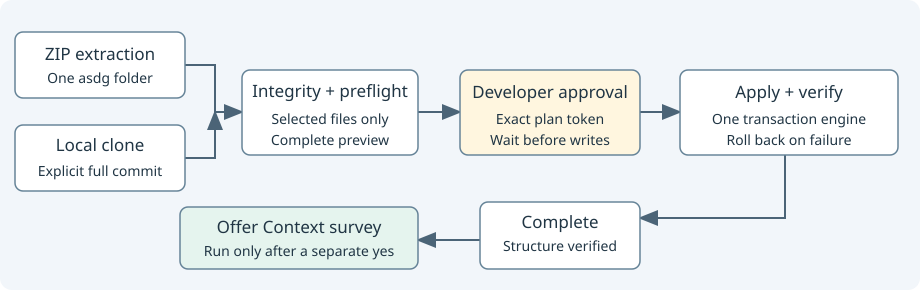

# ZIP and Clone installation review

Scope: “Use one deterministic Python initialization engine for both.” Implementation and disposable testing are authorized; no real promotion, upgrade or release is approved.

## Implemented

The existing project planner and file transaction now serve both extracted packages and explicitly pinned local canonical clones through `asdg/scripts/init.py`.
Default execution is a complete preview. Application requires `--apply --plan TOKEN`; the token binds source bytes/commit, target Git identity, selected client, generated timestamps and planned changes.

Clone acquisition verifies canonical origin, exact HEAD and committed regular-file blobs for every selected distribution member. ZIP acquisition checks the same selected-file manifest and package preflight.
Only selected portable files are copied. Provider extras, source project state and source Git metadata never enter the target; generated target integration/state remains distinct.

Codex and Claude share templates and canonical skills. Existing application files, authored Context and lifecycle records are preserved; collisions stop writes. Verification occurs inside rollback, including failed new-file writes.

Successful setup reports completion and offers Context without executing it. The thin prompts stop for installation approval, then stop again for separate survey consent. No hook trust, sprint or Git operation is granted.

## Evidence

| Check | Result |
| --- | --- |
| Python 3.15 regression suite | 125 tests passed before the three additional installer cases |
| Final Python 3.9.6 regression suite | All 128 tests passed |
| Final installer suite, Python 3.9.6 and 3.15 | 11 tests passed on each, including both routes × both clients and rollback |
| Actual Claude Code application | Not run; discovery, invocation and loaded instructions require human testing |
| Actual Codex application | Not run; discovery, invocation, hook trust and interception remain unverified |

Logs, exact task-relative changed paths, integrity/build results and final suite output are in [installation evidence](../../reviews/asdg-installation/).
The [ZIP prompt](../../../asdg/docs/install-zip-prompt.md) and [Clone prompt](../../../asdg/docs/install-clone-prompt.md) are copy-ready conversational interfaces; choose the host client explicitly.

## Boundaries and remaining human checks

The real canonical HEAD remains `7c5d0ca3869ca2bf6472ac7a408b809dc4823cf9`; the working implementation is not committed. A real Clone installation needs a reviewed commit containing these files and a matching manifest.
Any disposable clone commit used in testing is test evidence only, not a published canonical version. The local ZIP remains an unapproved candidate at the existing version.
Archive extraction precedes initialization: inspect the archive and do not extract over existing work. Embedded hashes check consistency, not independent source authenticity.
Rollback covers ordinary process failures, not machine crashes or hostile concurrent writers. Native trust is always a separate human action.

The 19 promotion conflicts remain outside this task. Lifecycle catalogue, specialist identities, acceptance gates, archived delivery manifests and earlier governance history are preserved.
No real promotion, reverse upgrade, commit, push, merge, tag, publication or sprint was performed.
