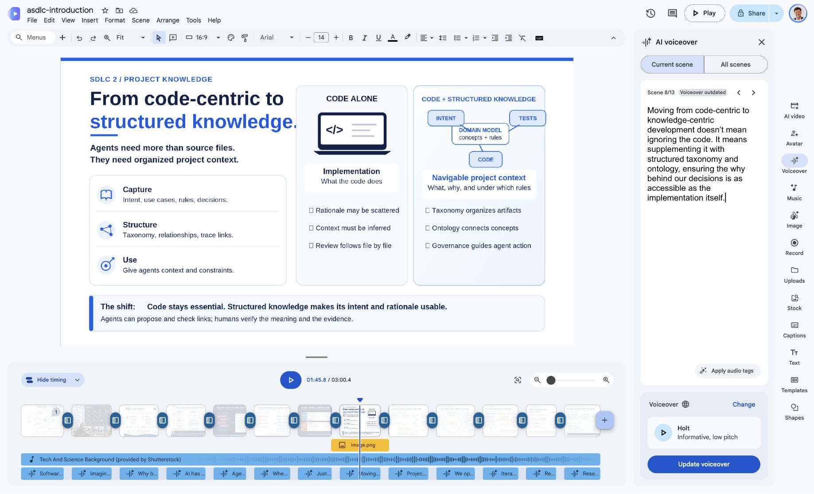

# Slide 08 — short-video narration

This is the short narration used by the earlier ASDLC overview, YouTube `RUyP6nvC8cE`. It is separate from the slide SVG and the longer introductory/walkthrough/details notes.

## Script

Moving from code-centric to knowledge-centric development doesn’t mean ignoring the code. It means supplementing it with structured taxonomy and ontology, ensuring the why behind our decisions is as accessible as the implementation itself.

## Source and export state

The corresponding [Google Vids scene 8](https://docs.google.com/videos/d/1Idhan4RV_u4CYKQBWOdShvn1wEZim4CQNu0rO-9duKc/edit?scene=id.h1005039f3aea78bd_0_22) now contains this wording, with quotation markup around why removed. The source reports Saved to Drive.

The existing generated Vids audio has not been regenerated; Vids flags Voiceover outdated. Do not export that stale audio as the corrected video. Regeneration would need the original voice/timing checked again.

For this correction, use the supplied MP4 with SHA-256 `0564ef958e9ebce10808c567160b5806c0668b630fadc3481445bd525b819c11`. It preserves the supplied corrected audio/captions and matching duration without a new voice synthesis.

The prepared release filename is `asdg-introduction-narrated.mp4` under this presentation’s ignored `build/release-correction/`. Hash/caption/stream checks do not establish an auditory listening check; see the [publication review](../../asdg/07-planning/02.21-review-presentation-publication.md).
